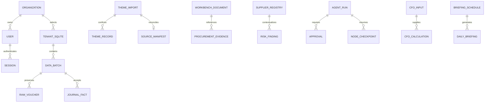

# 当前源码接口与数据字典

2026-11-07最新冻结源码。CURRENT_OPENAPI.json来自app.app.openapi()，LIVE_OPENAPI.json来自实际8000；两者分开保留，源码挂载不等于主服务已重载。未查询业务表内容。

源码路径122；运行服务路径122。源码较服务新增路径：.

## 源码接口索引

- GET /：Index；响应200
- GET /api/v1/admin/organizations：List Organizations；响应200
- POST /api/v1/admin/organizations：Organization；响应201,422
- GET /api/v1/admin/users：List Users；响应200
- POST /api/v1/admin/users：New User；响应201,422
- PATCH /api/v1/admin/users/{user_id}：Update User；响应200,422
- GET /api/v1/agent-runs：Listing；响应200
- POST /api/v1/agent-runs：Create；响应201,422
- GET /api/v1/agent-runs/{jid}：Detail；响应200,422
- POST /api/v1/agent-runs/{jid}/resume：Resume；响应200,422
- POST /api/v1/agent-runs/{jid}/review：Review；响应200,422
- GET /api/v1/agents：Agents；响应200
- POST /api/v1/analysis：Analysis；响应200,422
- POST /api/v1/analysis/confirm：Confirm；响应200,422
- POST /api/v1/analysis/plan：Plan；响应201,422
- GET /api/v1/analysis/{task_id}：Analysis Task；响应200,422
- GET /api/v1/audit：Audit Log；响应200
- POST /api/v1/auth/login：Login；响应200,422
- POST /api/v1/auth/logout：Logout；响应200
- GET /api/v1/auth/me：Me；响应200
- POST /api/v1/auth/password：Change Password；响应200,422
- GET /api/v1/auth/status：Auth Status；响应200
- GET /api/v1/bank/reconcile：Reconciliation；响应200,422
- GET /api/v1/bank/transactions：Listing；响应200
- POST /api/v1/bank/transactions：Register；响应201,422
- GET /api/v1/briefing-schedules：Listing；响应200
- POST /api/v1/briefing-schedules：Create；响应201,422
- POST /api/v1/briefing-schedules/{sid}/tick：Tick；响应200,422
- POST /api/v1/cfo/backtests：Backtest；响应200,422
- POST /api/v1/cfo/inputs：Create；响应201,422
- POST /api/v1/cfo/inputs/{jid}/approve：Approve；响应200,422
- GET /api/v1/cfo/inputs/{jid}/ratios：Calculate；响应200,422
- POST /api/v1/cfo/inputs/{jid}/scenario：Scenario；响应200,422
- GET /api/v1/cfo/overview：Cfo；响应200,422
- GET /api/v1/connectors：Listing；响应200
- POST /api/v1/connectors：Create；响应201,422
- POST /api/v1/connectors/{sid}/run：Execute；响应200,422
- POST /api/v1/durable-jobs：Create；响应202,422
- GET /api/v1/durable-jobs/{jid}：Read；响应200,422
- POST /api/v1/durable-jobs/{jid}/cancel：Stop；响应200,422
- GET /api/v1/enterprise/approvals：Approvals；响应200
- POST /api/v1/enterprise/approvals/{identifier}/review：Review；响应200,422
- GET /api/v1/enterprise/audit：Events；响应200
- GET /api/v1/enterprise/audit/verify：Audit Verify；响应200
- GET /api/v1/enterprise/periods：Periods；响应200
- POST /api/v1/enterprise/periods/{period}/close：Close；响应200,422
- POST /api/v1/enterprise/periods/{period}/reopen：Reopen；响应200,422
- GET /api/v1/enterprise/policy：Policy；响应200
- GET /api/v1/erp/accounts：Read；响应200
- POST /api/v1/erp/accounts：Create；响应200,422
- POST /api/v1/erp/accounts/import：Upload；响应200,422
- GET /api/v1/erp/accounts/template：Template；响应200
- POST /api/v1/erp/preview：Upload；响应201,422
- GET /api/v1/erp/profiles：Profiles；响应200
- GET /api/v1/erp/runs：Listing；响应200
- GET /api/v1/erp/runs/{identifier}：Detail；响应200,422
- POST /api/v1/erp/runs/{identifier}/clean：Cleaning；响应200,422
- POST /api/v1/erp/runs/{identifier}/commit：Confirm；响应200,422
- GET /api/v1/erp/runs/{identifier}/errors.csv：Errors；响应200,422
- POST /api/v1/erp/runs/{identifier}/request-approval：Request；响应201,422
- GET /api/v1/erp/runs/{identifier}/rows：Rows；响应200,422
- POST /api/v1/erp/source-preview：Preview；响应201,422
- GET /api/v1/erp/sources：Listing；响应200
- GET /api/v1/erp/templates/{profile}：Template；响应200,422
- GET /api/v1/exports/finance.docx：Word；响应200,422
- GET /api/v1/exports/finance.pdf：Pdf；响应200,422
- GET /api/v1/exports/finance.xlsx：Excel；响应200,422
- GET /api/v1/finance-query：Query；响应200,422
- GET /api/v1/finance-workbench/documents：Listing；响应200
- POST /api/v1/finance-workbench/documents：Create；响应201,422
- POST /api/v1/finance-workbench/documents/{jid}/publish：Publish；响应200,422
- POST /api/v1/finance-workbench/documents/{jid}/review：Review；响应200,422
- POST /api/v1/finance-workbench/documents/{jid}/voucher-draft：Draft；响应200,422
- POST /api/v1/finance-workbench/procurement/evidence：Create；响应201,422
- GET /api/v1/finance-workbench/procurement/{case_id}/match：Review；响应200,422
- GET /api/v1/finance-workbench/risks：Risks；响应200,422
- GET /api/v1/finance-workbench/suppliers：Listing；响应200
- POST /api/v1/finance-workbench/suppliers：Register；响应201,422
- GET /api/v1/finance/aging：Aging；响应200,422
- POST /api/v1/finance/bank-balance-reconciliation：Worksheet；响应200,422
- GET /api/v1/finance/budget：Budget；响应200,422
- GET /api/v1/finance/cashflow：Flow；响应200,422
- GET /api/v1/finance/cashflow/forecast：Prediction；响应200,422
- GET /api/v1/finance/departments：Departments；响应200,422
- POST /api/v1/finance/opening-balances：Add Opening；响应201,422
- GET /api/v1/finance/registers：Registers；响应200
- POST /api/v1/finance/registers：Create Register；响应201,422
- GET /api/v1/finance/statements/balance：Sheet；响应200,422
- GET /api/v1/finance/statements/income：Profit；响应200,422
- GET /api/v1/finance/statements/mappings：Mappings；响应200
- POST /api/v1/finance/statements/mappings：Add Mappings；响应200,422
- GET /api/v1/governance/dictionary：Dictionary；响应200
- GET /api/v1/governance/lineage/{batch_id}：Lineage；响应200,422
- GET /api/v1/health：Health；响应200
- GET /api/v1/imports：Batch List；响应200
- POST /api/v1/imports：Commit；响应202,422
- POST /api/v1/imports/preview：Preview；响应200,422
- GET /api/v1/imports/{bid}：Batch；响应200,422
- GET /api/v1/jobs：Listing；响应200
- POST /api/v1/jobs：Create；响应202,422
- GET /api/v1/jobs/{job_id}：Get；响应200,422
- POST /api/v1/jobs/{job_id}/cancel：Stop；响应200,422
- POST /api/v1/knowledge/documents：Add；响应201,422
- GET /api/v1/knowledge/hybrid-search：Hybrid；响应200,422
- GET /api/v1/knowledge/search：Knowledge；响应200,422
- POST /api/v1/knowledge/semantic-initialize：Initialize；响应200
- GET /api/v1/knowledge/semantic-search：Search；响应200,422
- GET /api/v1/knowledge/semantic-status：Status；响应200
- GET /api/v1/knowledge/sources/{sid}：Source；响应200,422
- POST /api/v1/knowledge/upload：Upload；响应201,422
- GET /api/v1/knowledge/vector-search：Search；响应200,422
- GET /api/v1/metrics/finance：Finance；响应200,422
- GET /api/v1/public-company：Overview；响应200
- GET /api/v1/public-company/annual-metrics：Metrics；响应200,422
- GET /api/v1/public-company/backtest：Forecast；响应200
- GET /api/v1/public-company/sources/{year}：Source；响应200,422
- GET /api/v1/ready：Ready；响应200
- GET /api/v1/reports：Report；响应200,422
- POST /api/v1/reports：Create Report；响应202,422
- GET /api/v1/reports/{task_id}：Report Task；响应200,422
- GET /api/v1/risks：Risks；响应200,422
- POST /api/v1/sales：Add Sale；响应201,422
- GET /api/v1/sales/summary：Sales；响应200,422
- GET /api/v1/template：Template；响应200
- GET /api/v1/theme-imports/{jid}：Detail；响应200,422
- POST /api/v1/theme-imports/{jid}/confirm：Confirm；响应200,422
- POST /api/v1/theme-imports/{jid}/revoke：Revoke；响应200,422
- GET /api/v1/theme-imports/{jid}/source：Source；响应200,422
- PUT /api/v1/theme-imports/{jid}/source-manifest：Manifest Put；响应200,422
- GET /api/v1/theme-imports/{jid}/source-manifest：Manifest Get；响应200,422
- POST /api/v1/theme-imports/{theme}/preview：Preview；响应201,422
- GET /api/v1/theme-templates/{theme}：Template；响应200,422
- GET /api/v1/warehouse/metrics：Query；响应200,422
- POST /api/v1/warehouse/publish/{batch_id}：Publish Batch；响应200,422
- GET /login：Login Page；响应200
- GET /operations：Operations；响应200
- GET /static/{filename}：Static Asset；响应200,422

## 源码字段字典

以下为源码MetaData声明，不是业务库反射；未声明FK不代表已有物理约束。payload字段的业务约束参阅OpenAPI及REDESIGN_DATABASE。

### dwd_fact_journal_entry

- id：VARCHAR PK, NOT NULL
- business_key：VARCHAR UNIQUE
- batch_id：VARCHAR 
- period：VARCHAR 
- currency：VARCHAR 
- category：VARCHAR 
- debit_cents：INTEGER 
- credit_cents：INTEGER 
- payload：TEXT 

### finance_bank_transaction

- id：VARCHAR PK, NOT NULL
- external_id：VARCHAR UNIQUE
- payload：TEXT 

### finance_statement_input

- id：VARCHAR PK, NOT NULL
- kind：VARCHAR 
- payload：TEXT 

### finance_statement_mapping

- code：VARCHAR PK, NOT NULL
- category：VARCHAR 
- line：VARCHAR 

### knowledge_original_file

- id：VARCHAR PK, NOT NULL
- organization：VARCHAR 
- payload：TEXT 

### knowledge_vector_document

- id：VARCHAR PK, NOT NULL
- payload：TEXT 

### metadata_agent_run

- id：VARCHAR PK, NOT NULL
- organization：VARCHAR 
- query：TEXT 
- result：TEXT 

### metadata_agent_run_approval

- id：VARCHAR PK, NOT NULL
- organization：VARCHAR 
- maker：VARCHAR 
- reviewer：VARCHAR 
- decision：VARCHAR 
- reason：TEXT 

### metadata_async_job

- id：VARCHAR PK, NOT NULL
- status：VARCHAR 
- attempts：INTEGER 
- payload：TEXT 

### metadata_audit

- id：VARCHAR PK, NOT NULL
- action：VARCHAR 
- resource：VARCHAR 
- created：VARCHAR 

### metadata_backend_task

- id：VARCHAR PK, NOT NULL
- payload：TEXT 

### metadata_briefing_schedule

- id：VARCHAR PK, NOT NULL
- organization：VARCHAR 
- payload：TEXT 

### metadata_cfo_approved_input

- id：VARCHAR PK, NOT NULL
- organization：VARCHAR 
- maker：VARCHAR 
- reviewer：VARCHAR 
- status：VARCHAR 
- payload：TEXT 
- hash：VARCHAR 

### metadata_cfo_calculation

- id：VARCHAR PK, NOT NULL
- organization：VARCHAR 
- payload：TEXT 

### metadata_connector

- id：VARCHAR PK, NOT NULL
- payload：TEXT 

### metadata_control_event

- sequence：INTEGER PK, NOT NULL
- payload：TEXT 
- previous_hash：VARCHAR 
- event_hash：VARCHAR 

### metadata_control_period

- period：VARCHAR PK, NOT NULL
- status：VARCHAR 
- version：INTEGER 
- actor：VARCHAR 
- reason：TEXT 
- updated：VARCHAR 

### metadata_daily_briefing

- id：VARCHAR PK, NOT NULL
- organization：VARCHAR 
- payload：TEXT 

### metadata_data_batch

- id：VARCHAR PK, NOT NULL
- sha256：VARCHAR UNIQUE
- source：VARCHAR 
- kind：VARCHAR 
- status：VARCHAR 
- details：TEXT 

### metadata_erp_account

- code：VARCHAR PK, NOT NULL
- name：VARCHAR 
- category：VARCHAR 

### metadata_erp_batch_link

- batch_id：VARCHAR PK, NOT NULL
- run_id：VARCHAR 

### metadata_erp_ledger

- id：VARCHAR PK, NOT NULL
- name：VARCHAR 

### metadata_erp_receipt

- id：VARCHAR PK, NOT NULL
- configuration：VARCHAR 
- batch_id：VARCHAR 

### metadata_erp_run

- id：VARCHAR PK, NOT NULL
- payload：TEXT 

### metadata_finance_register

- id：VARCHAR PK, NOT NULL
- kind：VARCHAR 
- business_key：VARCHAR UNIQUE
- payload：TEXT 

### metadata_import_approval

- id：VARCHAR PK, NOT NULL
- run_id：VARCHAR 
- cleaning_token：VARCHAR 
- source_digest：VARCHAR 
- snapshot_hash：VARCHAR 
- maker：VARCHAR 
- reviewer：VARCHAR 
- status：VARCHAR 
- reason：TEXT 
- created：VARCHAR 
- reviewed：VARCHAR 

### metadata_leased_job

- id：VARCHAR PK, NOT NULL
- organization：VARCHAR 
- kind：VARCHAR 
- status：VARCHAR 
- attempts：INTEGER 
- max_attempts：INTEGER 
- owner：VARCHAR 
- expires：FLOAT 
- input：TEXT 
- result：TEXT 
- error：VARCHAR 

### metadata_preview

- id：VARCHAR PK, NOT NULL
- digest：VARCHAR 
- source：VARCHAR 
- payload：TEXT 
- created：VARCHAR 

### metadata_procurement_evidence

- id：VARCHAR PK, NOT NULL
- organization：VARCHAR 
- case_id：VARCHAR 
- currency：VARCHAR 
- kind：VARCHAR 
- payload：TEXT 
- sha256：VARCHAR 
- maker：VARCHAR 

### metadata_supplier_registration

- id：VARCHAR PK, NOT NULL
- organization：VARCHAR 
- payload：TEXT 

### metadata_theme_import

- id：VARCHAR PK, NOT NULL
- organization：VARCHAR 
- file_key：VARCHAR UNIQUE
- status：VARCHAR 
- payload：TEXT 

### metadata_theme_record

- business_key：VARCHAR PK, NOT NULL
- organization：VARCHAR 
- row_hash：VARCHAR 
- payload：TEXT 

### metadata_theme_source_manifest

- id：VARCHAR PK, NOT NULL
- organization：VARCHAR 
- payload：TEXT 
- sha256：VARCHAR 

### metadata_workbench_document

- id：VARCHAR PK, NOT NULL
- organization：VARCHAR 
- maker：VARCHAR 
- status：VARCHAR 
- payload：TEXT 
- review：TEXT 
- draft：TEXT 
- external_id：VARCHAR UNIQUE
- snapshot_hash：VARCHAR 

### ods_erp_file

- id：VARCHAR PK, NOT NULL
- digest：VARCHAR UNIQUE
- content：BLOB 
- metadata：TEXT 

### ods_raw_vouchers

- id：VARCHAR PK, NOT NULL
- batch_id：VARCHAR 
- row_number：INTEGER 
- payload：TEXT 

### security_organization

- id：VARCHAR PK, NOT NULL
- name：VARCHAR 
- created_at：VARCHAR 

### security_session

- digest：VARCHAR PK, NOT NULL
- user_id：VARCHAR 
- expires：INTEGER 

### security_user

- id：VARCHAR PK, NOT NULL
- username：VARCHAR UNIQUE
- password_hash：VARCHAR 
- organization_id：VARCHAR 
- role：VARCHAR 
- enabled：INTEGER 
- failures：INTEGER 
- locked_until：INTEGER 

## 逻辑ER（并非物理外键声明）

控制库/组织SQLite/独立Harness与TaskMemory账本分开。PG强约束以迁移SQL和真实PG验收为准。

## PG迁移指纹

- 001_warehouse.sql SHA256 ee3946046f82b4f52a12f06b7d0faecce0ed4fa9a52419e91cd18e103ca8aeb5
- 002_controls.sql SHA256 0dfa0d3271b6db276c993d7a2f48e669f3cceae5e3006207fbbd89e7ad40a6a3
- 003_erp_provenance.sql SHA256 93957374e73174a63deead7235967a1bbe561e6877bb2cb1a91fd220b0434391
- 004_workbench_evidence.sql SHA256 292f637eecf1e5a133644eef55fc1751c9cf92385108ea1bb08dd372e8eb6d24
